# Every state of the page

> ## ⚠ 01–29 AND 31–36 ARE SYNTHETIC. ONLY 00 AND 30 ARE REAL TESTNET ANCHORS.
>
> Screenshots **01–29** and **31–36** (`*-synthetic-*.png`) show the page answering from
> **synthetic test data**: fixture chains served to the unmodified page by the
> test harness in place of the RPC. Nothing in them was anchored on any
> network. Their warehouse (`FIXTURE_WH`), lots, receipts, lender, dates,
> ledger numbers and anchoring times are made up, and each image carries a
> purple **SYNTHETIC TEST DATA** banner and watermark.
>
> Only **00** and **30** (`*-live-testnet-*.png`) are real: the page checking
> the Testnet example against Stellar's test network. Even those are **not a
> real deposit**: the example lot is synthetic, anchored on a test network.
>
> **Never present a synthetic screenshot as a real anchor.** If one goes in a
> slide, keep its banner visible and say it is synthetic.

Made by `npm run screenshots` (`test/page.test.js`), at 390 px wide, against the
site exactly as deployed. The page itself has no test or demo mode; the banner
and watermark are added by the test harness.

## 00 · REAL (Testnet) · The Testnet example, checked against the real Testnet: verified; part pledged, part released

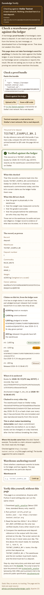

## 01 · SYNTHETIC · Landing page: the network banner, the trust distinction, input

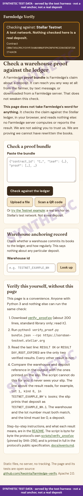

## 02 · SYNTHETIC · Verified; one unencumbered receipt

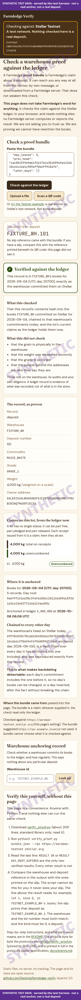

## 03 · SYNTHETIC · Verified; part pledged, part free, part released

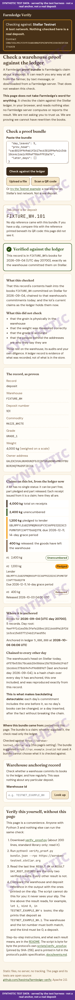

## 04 · SYNTHETIC · Verified; a lender has begun recovery (red banner above everything)

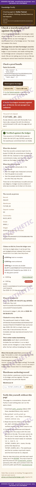

## 05 · SYNTHETIC · Verified; the whole lot released

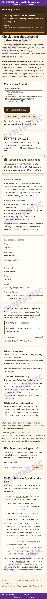

## 06 · SYNTHETIC · Verified; the receipt revoked

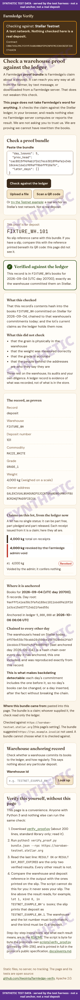

## 07 · SYNTHETIC · Verified; a released receipt archived on the ledger, explained

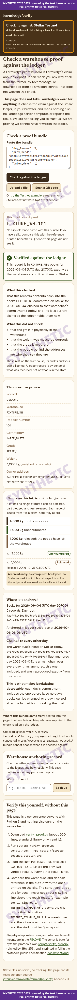

## 08 · SYNTHETIC · Verified; no receipt issued for the lot

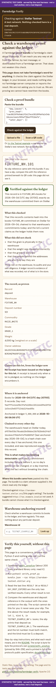

## 09 · SYNTHETIC · DAY_ROOT_EXPIRED: verified through the head chain, and why that is enough

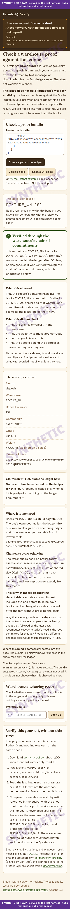

## 10 · SYNTHETIC · Verified; the warehouse's head archived, read and matched

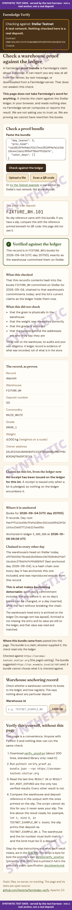

## 11 · SYNTHETIC · NOT_YET_ANCHORED: pending, not failed

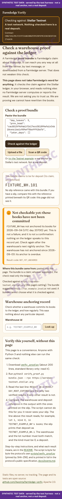

## 12 · SYNTHETIC · DAY_ROOT_DIFFERS: altered or forged

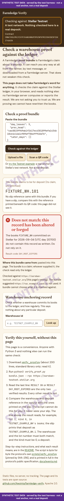

## 13 · SYNTHETIC · HEAD_MISMATCH: root on chain but not chained (how backdating shows up)

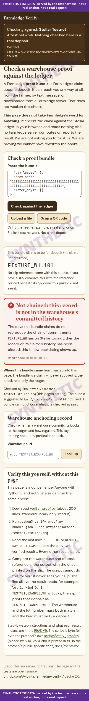

## 14 · SYNTHETIC · HEAD_MISMATCH: a bundle missing its later days

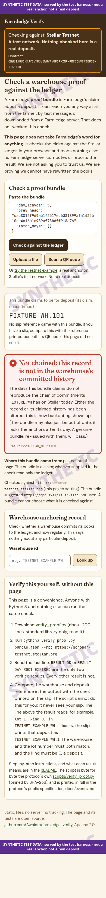

## 15 · SYNTHETIC · NO_HEAD: nothing anchored this claim

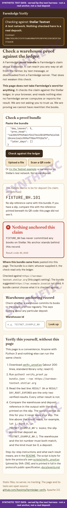

## 16 · SYNTHETIC · PROOF_DOES_NOT_FIT

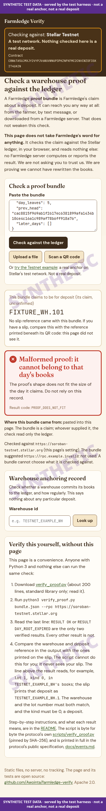

## 17 · SYNTHETIC · DAY_IN_FUTURE

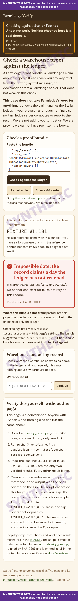

## 18 · SYNTHETIC · BAD_BUNDLE: nothing was checked

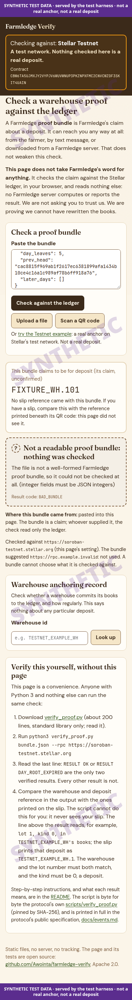

## 19 · SYNTHETIC · COULD_NOT_CHECK: RPC refused

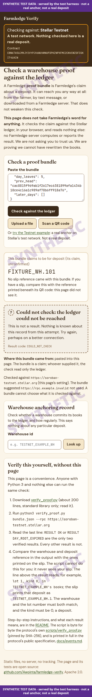

## 20 · SYNTHETIC · COULD_NOT_CHECK: RPC HTTP 500

## 21 · SYNTHETIC · COULD_NOT_CHECK: offline

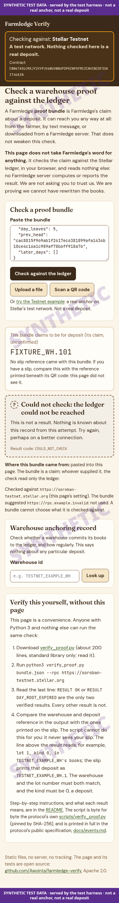

## 22 · SYNTHETIC · WRONG_NETWORK: refused, nothing read

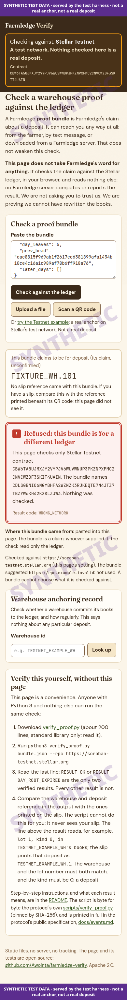

## 23 · SYNTHETIC · Progress while the lot's claims are read

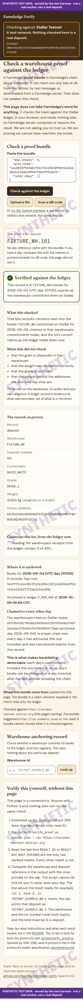

## 24 · SYNTHETIC · Verified, but the claims could not be read

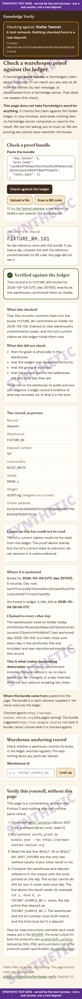

## 25 · SYNTHETIC · A tablet capture receipt QR: proves nothing

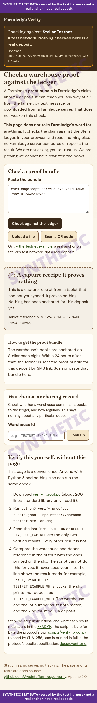

## 26 · SYNTHETIC · The post-sync slip leaf: a claim, not a proof

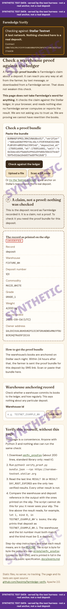

## 27 · SYNTHETIC · A deposit number typed in: not checkable

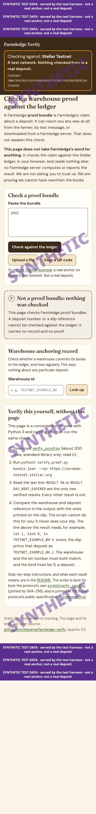

## 28 · SYNTHETIC · Warehouse anchoring record with a missed day

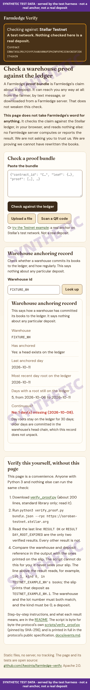

## 29 · SYNTHETIC · Warehouse anchoring record: no anchor

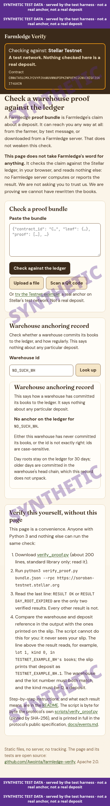

## 30 · REAL (Testnet) · Warehouse anchoring record for the Testnet example warehouse

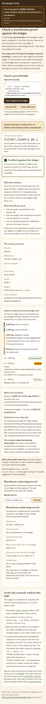

## 31 · SYNTHETIC · A slip link on the deployed page, which has no proof API yet: the slip's reference, nothing fetched

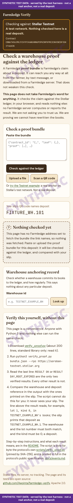

## 32 · SYNTHETIC · Verified, and the deposit matches the slip's reference

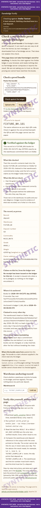

## 33 · SYNTHETIC · SLIP_MISMATCH (page check): the proof is valid, and it is for a different deposit than the slip

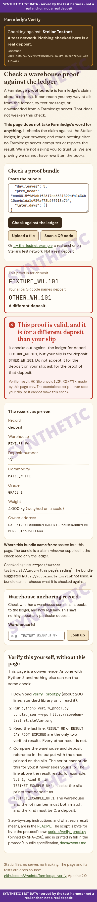

## 34 · SYNTHETIC · A forged bundle with a slip that does not match: the verification failure comes first

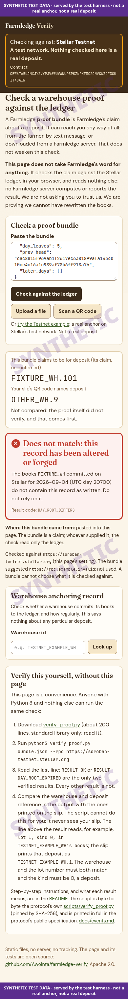

## 35 · SYNTHETIC · A slip token fetched from a proof API (served by the harness: none is public yet)

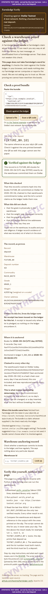

## 36 · SYNTHETIC · A slip link with no reference: verified, and said to be uncompared with the slip

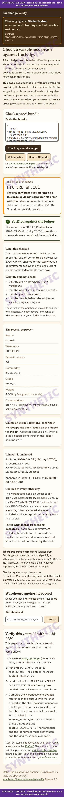
