# Every state of the page

Made by `npm run screenshots` (`test/page.test.js`) at 390 px wide. Except `00` and `30`, which ran against the real Testnet, every screenshot is the page answering from a **test fixture's chain**, served in place of the RPC by the test harness: synthetic data, not a real or Testnet deposit. The page itself has no test or demo mode.

## 00-testnet-example-live

The Testnet example, checked against the real Testnet: OK, part pledged, part released

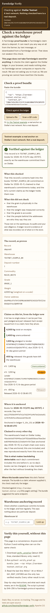

## 01-landing

Landing page: the network banner, the trust distinction, input

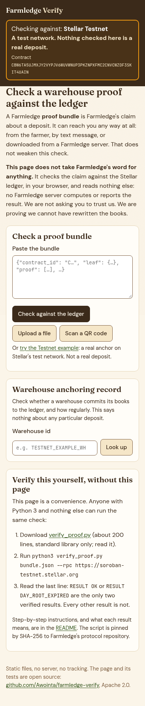

## 02-ok-active

Verified; one unencumbered receipt

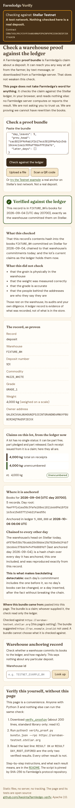

## 03-ok-pledged

Verified; part pledged, part free, part released

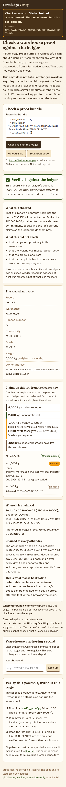

## 04-ok-recovery

Verified; a lender has begun recovery (red banner above everything)

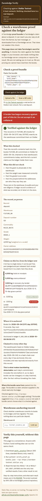

## 05-ok-exited

Verified; the whole lot released

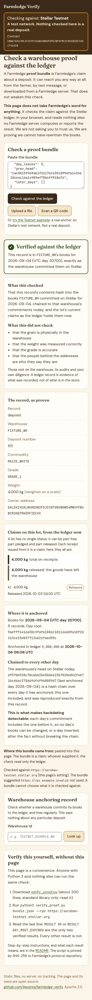

## 06-ok-revoked

Verified; the receipt revoked

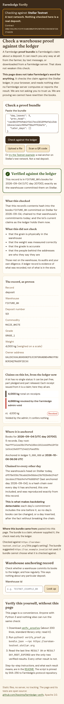

## 07-ok-archived-receipt

Verified; a released receipt archived on the ledger, explained

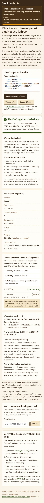

## 08-ok-no-receipt

Verified; no receipt issued for the lot

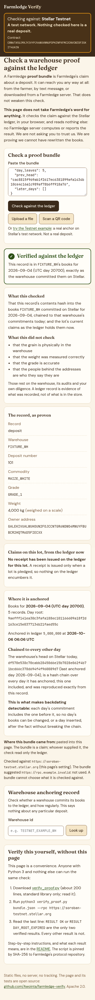

## 09-day-root-expired

DAY_ROOT_EXPIRED: verified through the head chain, and why that is enough

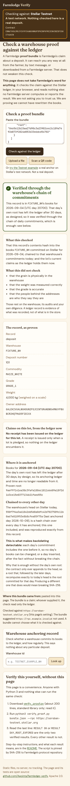

## 10-head-archived

Verified; the warehouse's head archived, read and matched

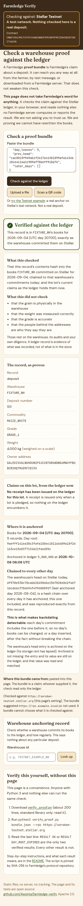

## 11-not-yet-anchored

NOT_YET_ANCHORED: pending, not failed

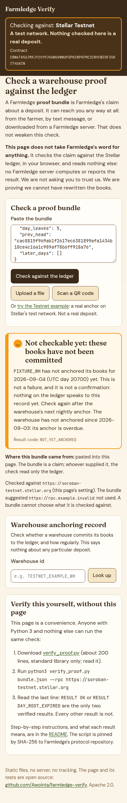

## 12-forged-day-root-differs

DAY_ROOT_DIFFERS: altered or forged

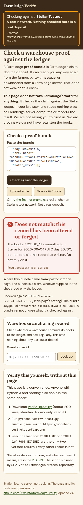

## 13-unchained-head-mismatch

HEAD_MISMATCH: root on chain but not chained (backdating)

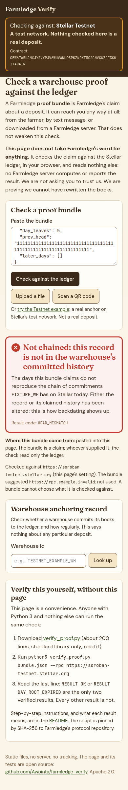

## 14-stale-bundle-head-mismatch

HEAD_MISMATCH: a bundle missing its later days

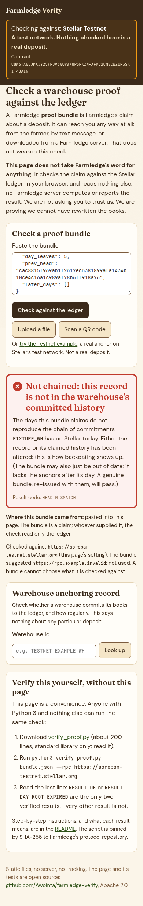

## 15-no-head

NO_HEAD: nothing anchored this claim

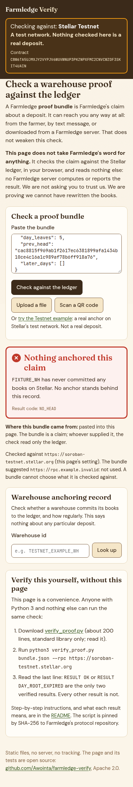

## 16-proof-does-not-fit

PROOF_DOES_NOT_FIT

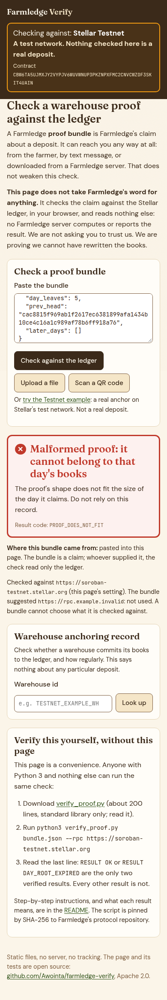

## 17-day-in-future

DAY_IN_FUTURE

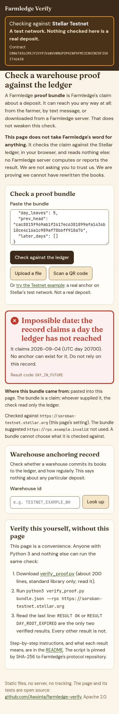

## 18-bad-bundle

BAD_BUNDLE: nothing was checked

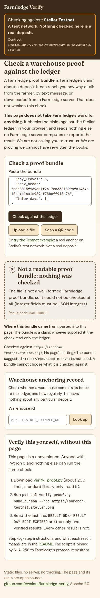

## 19-could-not-check-refused

COULD_NOT_CHECK: RPC refused

## 20-could-not-check-http-error

COULD_NOT_CHECK: RPC HTTP 500

## 21-could-not-check-offline

COULD_NOT_CHECK: offline

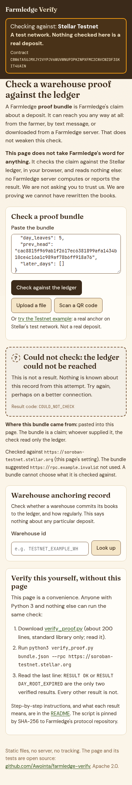

## 22-wrong-network

WRONG_NETWORK: refused, nothing read

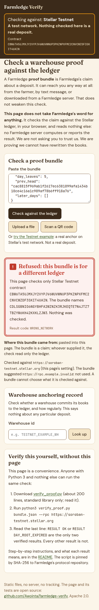

## 23-claims-progress

Progress while the claims are read

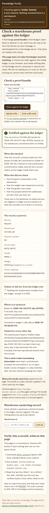

## 24-ok-claims-unreadable

Verified, but the claims could not be read

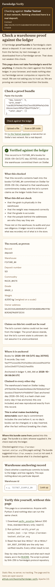

## 25-capture-receipt

A tablet capture receipt QR: proves nothing

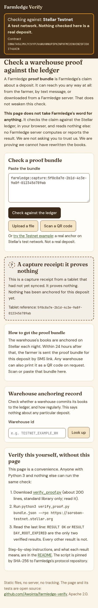

## 26-slip-leaf-unverified

The post-sync slip leaf: a claim, not a proof

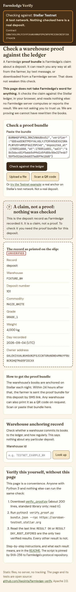

## 27-not-a-bundle

A deposit number typed in: not checkable

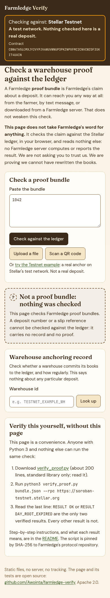

## 28-warehouse-gap

Warehouse anchoring record with a missed day

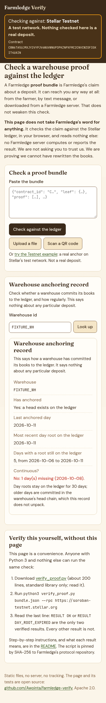

## 29-warehouse-none

Warehouse anchoring record: no anchor

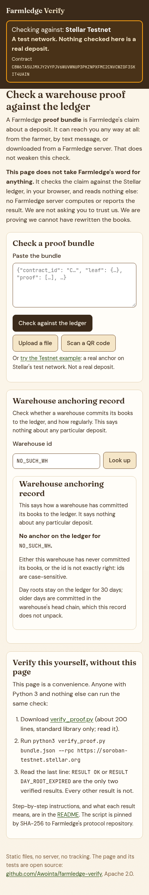

## 30-warehouse-live

Warehouse anchoring record for the Testnet example warehouse, live

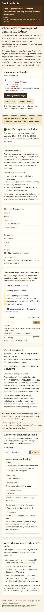
